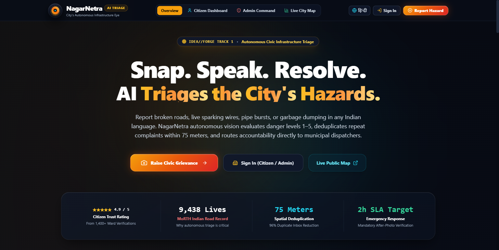
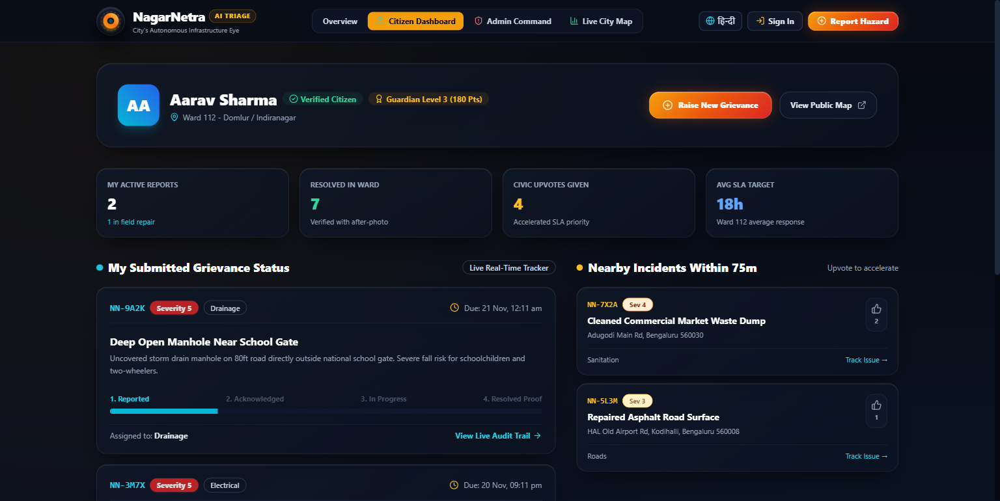
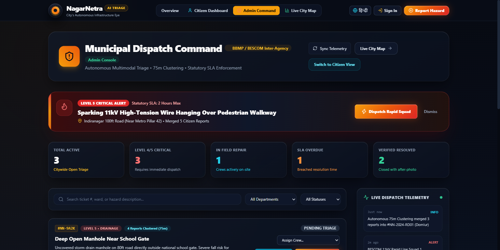
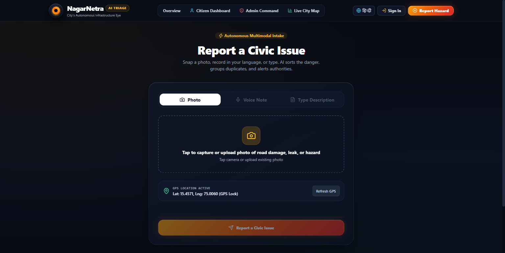
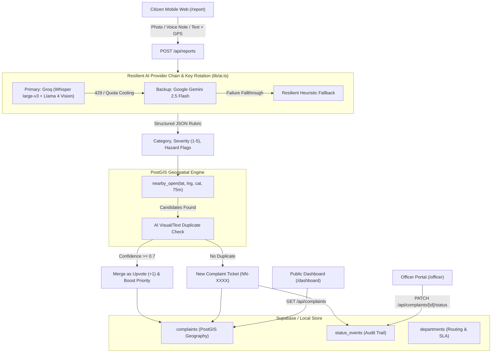

# NagarNetra (नगरनेत्र) — AI Civic Grievance & Infrastructure Triage

> **Track 1, Problem 2 (IDEA//FORGE)**: Urban Infrastructure & Public Safety Triage  
> **Pitch:** Snap, speak or type a civic problem in any Indian language; Multimodal AI rates severity, groups duplicates within 75m, routes to the right municipal department with statutory SLA deadlines, and monitors progress on a public city map with photo proof of resolution.

---

## Visual Interface & Architecture Preview

| Landing & AI Triage Overview | Citizen Ward Tracking Dashboard |
|---|---|
|  |  |

| Municipal Command Console | Autonomous Multimodal Intake |
|---|---|
|  |  |

---

## 1. Problem Statement & Real-World Evidence

Urban citizens face broken roads, open manholes, leaking water mains, rotting garbage piles, and electrocution hazards daily, but reporting them is cumbersome, English-only, and confusing. On the receiving end, **municipal engineers receive duplicate, unsorted, and unprioritized complaints with zero indication of which hazard threatens human life.**

### Official Data Cited:
- **Pothole deaths rose 53% in five years**: **9,438 people killed between 2020 and 2024** ([MoRTH official parliamentary data](https://www.outlookindia.com/national/pothole-deaths-in-india-rise-53-in-5-years-9438-killed-between-2020-2024)).
- Central portal CPGRAMS handled **over 26 lakh grievances in 2024**, excluding fragmented city helplines and WhatsApp portals ([Deccan Herald](https://www.deccanherald.com/amp/story/india%2Frecord-over-26-lakh-public-grievances-redressed-in-2024-union-minister-jitendra-singh-3453011)).
- Under-reporting of dangerous hazards obscures accountability and delays emergency response ([Bengaluru case](https://www.deccanherald.com/india/karnataka/bengaluru/pothole-deaths-under-reported-in-bengaluru-offenders-go-unpunished-1156517.html)).

---

## 2. System Architecture



---

## 3. Dynamic Priority Formula

Complaints in the officer dispatch queue are sorted dynamically by danger and public urgency:
$$\text{Priority} = (\text{Severity} \times 20) + \min(\text{Duplicate Count}, 10) \times 3 + (\text{Near Sensitive} ? 10 : 0) + (\text{Hours Overdue} \times 0.5)$$

* **Severity (1-5)**: Rates immediate life threat (open manhole = 5, wire = 5, water leak = 4, pothole = 3–4, crack = 1).
* **Near Sensitive**: Automatically flagged if AI detects schools, hospitals, pedestrian crossings, or high-speed roads.
* **Hours Overdue**: Escalates priority continuously when statutory department SLA target is breached.

---

## 4. Statutory Department Routing & SLA Table

| Category | Assigned Department | Statutory SLA (Hours) by Severity (5 / 4 / 3 / 2 / 1) |
|---|---|---|
| `roads` | Roads & Infrastructure (PWD/ULB) | 4h / 24h / 72h / 168h / 336h |
| `water` | Water Supply Board (BWSSB) | 4h / 12h / 48h / 120h / 240h |
| `drainage` | Storm Water Drains (SWD) | 4h / 24h / 72h / 168h / 336h |
| `sanitation` | Solid Waste Management (SWM) | 12h / 24h / 48h / 96h / 168h |
| `electrical` | Electricity / Streetlights (BESCOM) | 2h / 12h / 48h / 120h / 240h |
| `pollution` | Pollution Control / Environment (KSPCB) | 6h / 24h / 72h / 168h / 336h |
| `other` | Ward Citizen Services Office | 24h / 48h / 96h / 168h / 336h |

---

## 5. Quickstart & Local Setup

### Prerequisites
- Node.js 18+ (tested on Node v24)
- npm or bun

### 1. Clone & Install Dependencies
```bash
git clone https://github.com/Praful0306/IdeaForge_nxtWave.git
cd IdeaForge_nxtWave
npm install --legacy-peer-deps
```

### 2. Configure Environment Variables
Copy `.env.example` to `.env.local`:
```bash
cp .env.example .env.local
```
Provide your API keys (optional: app automatically uses the verified heuristic fallback engine if keys are absent):
```env
NEXT_PUBLIC_SUPABASE_URL=https://your-project.supabase.co
NEXT_PUBLIC_SUPABASE_ANON_KEY=your-anon-key
SUPABASE_SERVICE_ROLE_KEY=your-service-role-key

GROQ_API_KEY_1=gsk_...
GEMINI_API_KEY_1=...
OFFICER_PIN=7789
```

### 3. Run Development Server
```bash
npm run dev
```
Open [http://localhost:3000](http://localhost:3000) in your browser.

### 4. Run Test Suite & AI Evaluation
```bash
# Run Vitest Unit & Negative API tests (19/19 passing)
npx vitest run

# Run AI Evaluation Suite across 11 test cases
npx tsx scripts/eval-ai.ts

# Run Full Lifecycle Integration Audit (6/6 stages passing)
npx tsx scripts/verify-full-flow.ts
```

---

## 6. Officer Portal Security

- **Route:** `/officer`
- **Default PIN:** `7789`
- Guarded by an `httpOnly`, `SameSite=lax` session cookie.
- Officers can Acknowledge, Mark in Progress, Reject, or Resolve tickets with mandatory "after" photo proof.

---

## 7. Credits & Acknowledgements

- **Next.js & React**: Modern App Router web framework.
- **Supabase**: PostgreSQL database with PostGIS geospatial extension & media storage.
- **Groq API**: High-speed inference using Meta Llama 4 Vision & Whisper large-v3.
- **Google Gemini API**: Gemini 2.5 Flash multimodal backup engine.
- **OpenStreetMap & Leaflet**: Free global maps and spatial clustering.
- **Nominatim**: Open reverse-geocoding service.
- **Recharts**: Responsive data visualization.
- **Claude Code (Anthropic)**: Agentic engineering and scaffolding.
- **Data Sources**: Ministry of Road Transport and Highways (MoRTH) Parliamentary replies; Department of Administrative Reforms and Public Grievances (DARPG/CPGRAMS).
